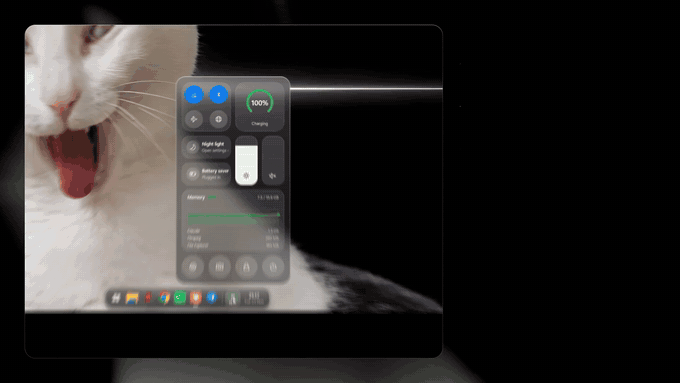

# GlassDock

A liquid-glass dock that replaces the Windows 11 taskbar. Written in Rust with plain Win32 + Direct2D: no web view, no framework.

[Watch the full video with sound (42 s)](docs/video/glassdock-demo.mp4)

## Download

| Platform | File | Size |
| :--- | :--- | :--- |
| **Windows 11** (64-bit) | [GlassDock-Setup-1.2.1.exe](https://github.com/K4ZED/GlassDock/releases/download/v1.2.1/GlassDock-Setup-1.2.1.exe) | ~2.5 MB |

Click the file name, run the installer, done. No admin rights needed. GlassDock starts at sign-in and updates itself.

## Features

- **Glass dock** with pinned and running apps, smart auto-hide, Wi-Fi inside a battery ring, clock.
- **Start menu**: the Windows key opens a glass Start with search-as-you-type.
- **Control Center**: Wi-Fi, Bluetooth and Airplane switch right in the panel, plus Battery saver, brightness, volume and a live memory graph.
- **Power card**: Sleep, Restart, Shut down, Sign out.
- **Calendar** on the clock.
- **Glass volume and brightness indicators** instead of the Windows flyouts.
- **Glass right-click menu**: pin, reorder, auto-hide and Clear / Frosted / Dark styles that apply live.
- **Self-updating**: a glass notice when a new version is out, one click to install.

## RAM: GlassDock vs the Windows parts it replaces

| | RAM (private) |
| :--- | ---: |
| Windows Start menu (`StartMenuExperienceHost`) | 125 MB |
| Windows Search (`SearchHost`) | 81 MB |
| Windows Quick Settings, calendar and notifications (`ShellExperienceHost` + `ShellHost`) | 89 MB |
| Windows Widgets service | 5 MB |
| **Windows total** | **~300 MB** |
| **GlassDock: dock, Start, Control Center, Calendar and indicators** | **~55 MB** |

Measured on 25 Nov 2026 on a 16 GB laptop with Windows 11 25H2. Windows keeps its own parts loaded while GlassDock runs, so this compares size, not memory saved: the whole system uses the same RAM with or without GlassDock (8,457 MB vs 8,458 MB).

## Usage

| Action | Result |
| --- | --- |
| Click / middle-click an app | Open, switch to or minimize it / open a new window |
| Right-click an app or the dock | Glass menu: pin, move, auto-hide, style, check for updates, quit |
| Windows key or Start button | Glass Start menu |
| Wi-Fi/battery ring · clock | Control Center · Calendar |
| Volume and brightness keys | Glass indicator above the dock |

## Uninstall

**Settings → Apps → Installed apps → GlassDock**. The Windows taskbar comes back.

## Known limitations

- Tray icons of other apps are not shown. Use *Show Windows taskbar* from the right-click menu when you need them.
- Primary monitor only. Brightness works on built-in laptop screens only.
- Night light has no public API, so its tile opens Settings.
- On ASUS laptops the keyboard backlight key (Fn+F4) keeps the ASUS indicator.

## Build from source

See [docs/DEVELOPMENT.md](docs/DEVELOPMENT.md): build, installer, release steps, settings files and project layout.
