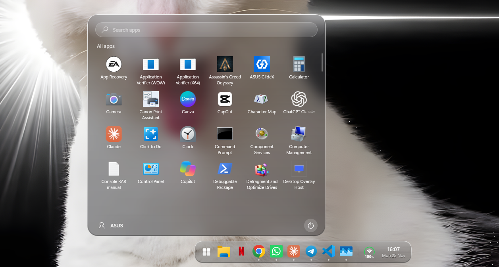
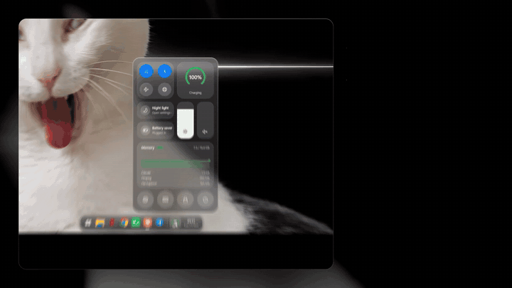
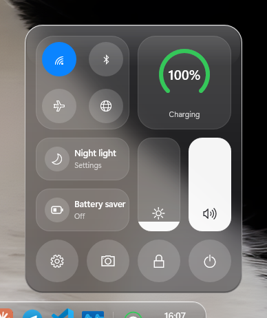
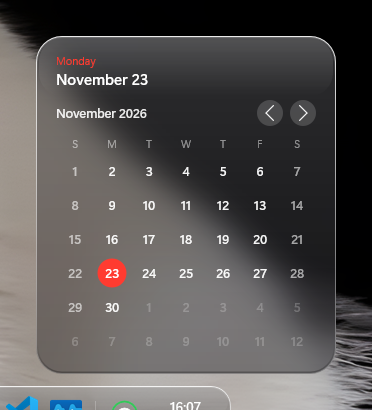
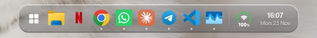

# GlassDock

A lightweight liquid-glass dock that replaces the Windows 11 taskbar, written in Rust with plain Win32 + Direct2D (no web view, no framework).



## Download

| Platform | File | Size |
| :--- | :--- | :--- |
| **Windows 11** (64-bit) | [GlassDock-Setup-1.2.0.exe](https://github.com/K4ZED/GlassDock/releases/download/v1.2.0/GlassDock-Setup-1.2.0.exe) | ~2.5 MB |

Click the file name to download the installer, then run it. No admin rights are needed, and after this GlassDock updates itself. Older versions and release notes are on the [Releases](https://github.com/K4ZED/GlassDock/releases) page.

## What's new in 1.2



[Watch the full video with sound (37 s)](docs/video/glassdock-1.2.0.mp4)

## Screenshots

| Control Center | Calendar |
| :---: | :---: |
|  |  |

**Dock**: pinned and running apps, Wi-Fi icon inside the battery ring, clock



## Features

- **Centered glass dock** at the bottom of the screen: pinned and running apps, open/active indicators.
- **Smart auto-hide**: the dock stays visible until a window overlaps it (or is maximized), then slides away; move the cursor to the bottom middle of the screen to bring it back. Also available: always hide, never hide.
- **Readable on any background**: layered edge shadow and a 1 px inner border, and the glass darkens automatically over bright windows so the clock stays readable.
- **iPhone-style status**: Wi-Fi icon inside a battery ring, battery percentage underneath, `HH:mm` clock and date.
- **Glass panels** that open above the dock with a fade/slide animation and a blurred background:
  - **Start menu**: search-as-you-type plus a grid of all installed apps. The Windows key opens this instead of the built-in Start.
  - **Control Center**: Wi-Fi, Bluetooth and Airplane buttons that switch the radios directly (and follow changes made elsewhere), a network button that opens the Windows Wi-Fi list, battery ring, a Battery saver tile that turns it on/off directly (Windows only allows this on battery), a Night light shortcut to Settings, vertical brightness and volume sliders, a live **memory graph** (last 60 s, used/total GB, the three apps using the most RAM; click it for Task Manager), Settings/Screenshot/Lock/Power.
  - **Power card**: the power button in Control Center or Start dims the panel and shows a glass card with Sleep, Restart, Shut down and Sign out (Esc or Cancel closes it).
  - **Calendar**: month view with today highlighted.
- **Glass volume and brightness indicators**: the volume keys and the screen brightness keys show a glass pill with the level above the dock instead of the Windows flyout.
- Hides the Windows taskbar while running and restores it on exit.
- **Glass right-click menu** on the dock and its app icons: app actions, Auto-hide and Glass style as segmented buttons that apply right away, a Windows taskbar switch, Check for updates and Quit.
- Three glass styles (Clear, Frosted, Dark); any remaining Windows menus are forced to dark mode.
- Small: ~500 KB executable, roughly 15–60 MB of RAM depending on which panels have been used.

## Install

Download the installer from the [Download](#download) table above and run it. No admin rights are needed: it installs for the current user, adds a Start Menu shortcut, and (optional, on by default) starts GlassDock as soon as you sign in (a per-user scheduled task, with a Run entry and a Startup-folder shortcut as backups). Uninstall it from **Settings → Apps → Installed apps**; the Windows taskbar comes back, and you can choose whether to keep your settings.

## Updating

**From 1.2.0 on**, GlassDock checks [GitHub Releases](https://github.com/K4ZED/GlassDock/releases) once a day (and when you choose **Check for updates** in the dock's right-click menu). When a newer version is out, a glass notice appears above the dock: click **Update** and GlassDock downloads the new installer, installs it and restarts by itself. Your pinned apps and settings are kept. If you close the notice, **Update to x.y.z** stays in the right-click menu.

**Coming from the first version (v1, installed with `install.ps1`)**: that version cannot check for updates, so update once by hand. Download `GlassDock-Setup-<version>.exe` from Releases and run it. It closes the old dock, installs over it in the same folder (`%LOCALAPPDATA%\GlassDock`) and keeps your pins and settings (`%APPDATA%\GlassDock`). From then on, updates come through the dock.

### Publishing a release (maintainers)

1. Raise `version` in `Cargo.toml` and `AppVersion` in `installer\GlassDock.iss` (they must match).
2. Run `.\build-installer.ps1`.
3. On GitHub, create a release with the tag `v<version>` (for example `v1.3.0`), not marked as pre-release, and attach `installer\Output\GlassDock-Setup-<version>.exe`.
4. In the [Download](#download) table of this README, change the version in the file name and in the link (`releases/download/v<version>/GlassDock-Setup-<version>.exe`), and the size if it changed.

The dock only offers releases whose tag is newer than its own version and that include a `GlassDock-Setup-*.exe` file. To try the update flow without publishing, put the path of a JSON file shaped like the GitHub release API answer into `%APPDATA%\GlassDock\update-feed.txt` (delete the file afterwards).

## Requirements (to build from source)

- Windows 10/11
- [Rust](https://rustup.rs) (stable, MSVC toolchain)
- Visual Studio Build Tools with the **Desktop development with C++** workload (for `link.exe` and the Windows SDK)

## Build

```powershell
cargo build --release
```

The executable is written to `target\release\glassdock.exe`.

## Build the installer

Needs [Inno Setup 6](https://jrsoftware.org/isinfo.php) (`winget install JRSoftware.InnoSetup`):

```powershell
.\build-installer.ps1
```

The installer is written to `installer\Output\GlassDock-Setup-<version>.exe`. The script is `installer\GlassDock.iss`.

## Developer install / uninstall (without the installer)

```powershell
.\install.ps1
```

This copies the executable to `%LOCALAPPDATA%\GlassDock`, registers it to start at login (scheduled task, Run entry and Startup-folder shortcut; current user only, no admin rights needed), and starts it. Run it again after every rebuild to update the installed copy.

```powershell
.\uninstall.ps1
```

This stops auto-start, closes the dock and brings the Windows taskbar back.

GlassDock logs each start, failed start attempts (it retries for about a minute when Windows is not ready yet at sign-in) and crashes to `%TEMP%\glassdock-crash.log`. If it crashes, it brings the Windows taskbar back. If the dock is killed from outside (for example with *End task*), the taskbar stays hidden: run **GlassDock - restore Windows taskbar** from the Start Menu, or `restore-taskbar.ps1`.

## Usage

| Action | Result |
| --- | --- |
| Click an app icon | Open it, switch to its window, or minimize it |
| Middle-click an app icon | Open a new window |
| Right-click an app icon | Open new window, close all windows, pin/unpin, move left/right |
| Right-click the dock | Auto-hide, glass style, show/hide Windows taskbar, check for updates, quit |
| Click Start / press the Windows key | Glass Start menu (type to search, Enter to open the first result) |
| Click the Wi-Fi/battery ring | Control Center |
| Click the clock | Calendar |
| Volume up/down/mute keys | Change the volume and show the glass volume indicator |
| Screen brightness keys (e.g. Fn+F5/F6) | Show the glass brightness indicator (the Windows flyout is hidden) |

## Settings files

Stored in `%APPDATA%\GlassDock`:

- `pins.txt`: pinned apps, one per line, in dock order. `lnk:<name>` = shortcut in the taskbar pin folder, `app:<AppID>` = Store app (list AppIDs with `Get-StartApps`), `exe:<path>` = program.
- `style.txt`: `clear`, `frosted` or `dark`.
- `autohide.txt`: `smart` (default: hide only when a window overlaps the dock), `1` (always) or `0` (never).
- `update-check.txt`: time of the last update check.

The default pin list used on first run is the `PINS` constant in `src/main.rs`.

## Project layout

| File | Contents |
| --- | --- |
| `src/main.rs` | Dock window, layout, drawing, auto-hide, taskbar hiding, Windows-key hook |
| `src/panels.rs` | Start menu, Control Center, Calendar and power card |
| `src/osd.rs` | Glass volume and brightness indicators |
| `src/update.rs` | Daily update check (GitHub Releases), update notice, one-click install |
| `src/apps.rs` | Pins, running windows, app icons, launching |
| `src/sys.rs` | Battery, Wi-Fi, Wi-Fi/Bluetooth radios (WinRT), Battery saver, volume (Core Audio), brightness (WMI), memory, acrylic, dark menus |

## Known limitations

- Tray icons from other apps (the area at the right end of the Windows taskbar) are not shown in the dock. Use *Show Windows taskbar* from the dock's right-click menu when you need them.
- Brightness control works for built-in laptop screens only (WMI), not external monitors. On ASUS laptops the keyboard backlight key (Fn+F4) keeps the ASUS indicator: the ASUS app runs as administrator, so GlassDock cannot hide it and does not show a second one.
- Night light has no public API, so its tile opens Settings.
- Primary monitor only.
- Uses a few undocumented Windows functions (`SetWindowCompositionAttribute` for acrylic, uxtheme ordinals 135/136 for dark menus) that a future Windows update could change.
